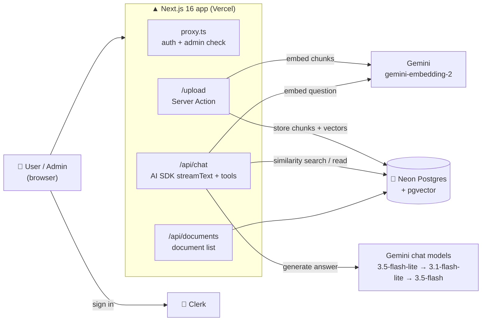
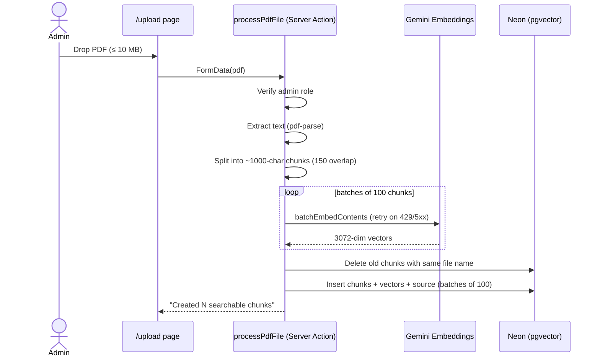
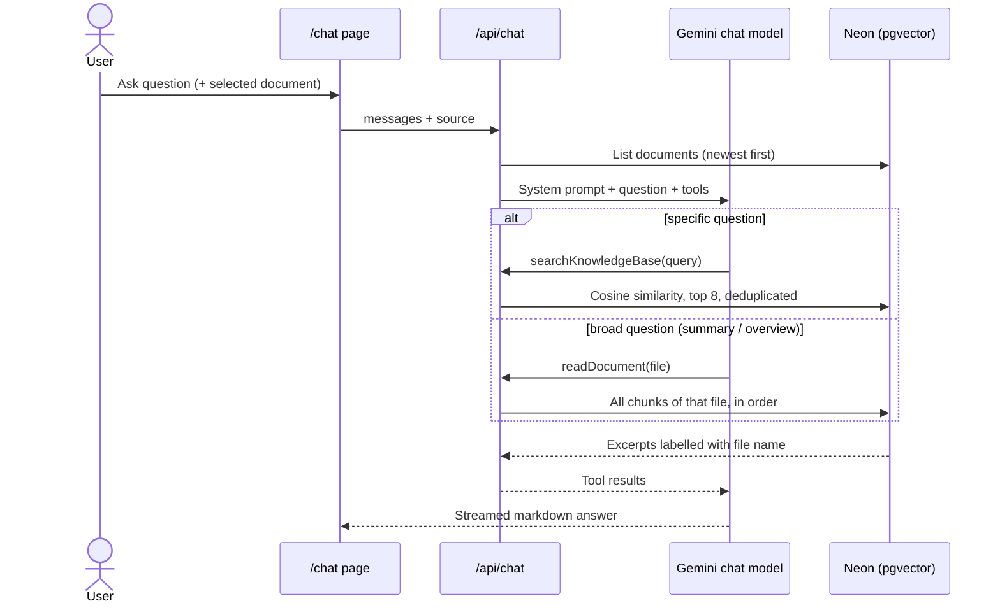

# 🧠 DocuMind: Chat with your PDFs

**DocuMind** is a full-stack **RAG (Retrieval-Augmented Generation) chatbot**. An admin uploads PDFs; signed-in users ask questions in plain language and get answers grounded in those documents. The model retrieves relevant passages first and is instructed to answer only from them.

Built with **Next.js 16**, **Vercel AI SDK 6**, **Google Gemini**, **Neon Postgres + pgvector**, **Drizzle ORM** and **Clerk**.

🔗 **Live demo:** [documind-sigma-pearl.vercel.app](https://documind-sigma-pearl.vercel.app/)

---

## ✨ Features

### 💬 Chat
- **Ask anything about your documents**: specific facts ("what was the sample size?") or broad questions ("summarize this PDF").
- **Document picker**: chat with **All documents** or lock the conversation to **one PDF**. When a PDF is selected, every search is restricted to that file, so answers can't leak in from other documents.
- **Agentic retrieval**: the model decides which tool to use:
  - `searchKnowledgeBase`: semantic vector search for specific questions
  - `readDocument`: reads a whole document for summaries and overviews
  It can search several times with different wording before answering.
- **Grounded answers**: the model is instructed to answer only from retrieved text and to say when something isn't in the documents, rather than guess.
- **Streaming, formatted replies**: answers stream in live and render as markdown (bold, lists, tables, code).
- **Resilient**: if Gemini is overloaded, the app automatically falls back to another model. If every model fails, you get a clear error and a **Retry** button.

### 📄 Upload (admin only)
- Drag & drop or browse to choose a PDF, with a file preview and size check (up to 10 MB).
- The text is extracted, chunked, embedded and stored automatically.
- **Re-uploading a file with the same name replaces** its old version, with no duplicates.
- Large PDFs are embedded in batches with automatic retry on Gemini rate limits.
- **"Chat with this PDF"** opens the chat with the new document already selected.

### 🔐 Auth & roles
- Sign in / sign up with **Clerk**.
- **Role-based access**: only users with the `admin` role can open the upload page or call the upload action. Everyone else can chat.
- After sign-in, admins land on **/upload** and other users on **/chat**.

### 🎨 UI
- Responsive design for mobile and desktop, plus light/dark/system theme toggle.
- Built with Tailwind CSS 4, shadcn/ui, AI Elements and Framer Motion.

---

## 🏗️ Architecture



### 📥 Upload pipeline



### 💬 Question answering



---

## 🔍 How it works in detail

### 1. Ingestion (`src/app/upload/actions.ts`)
| Step | Implementation |
|---|---|
| Access check | `isAdmin()` reads the `role` claim from the Clerk session token. Non-admins are rejected. |
| Text extraction | [`pdf-parse`](https://www.npmjs.com/package/pdf-parse). Only selectable text is extracted (no OCR). |
| Chunking | LangChain `RecursiveCharacterTextSplitter`: **1000 chars**, **150 overlap**, splitting on paragraphs → lines → sentences → words (`src/lib/chunking.ts`) |
| Embeddings | Gemini **`gemini-embedding-2`** (3072 dimensions), batches of 100, exponential-backoff retry on 429/5xx (`src/lib/embeddings.ts`) |
| Storage | Each chunk is stored with its vector, source file name and timestamp. Existing chunks with the same file name are deleted first. |

### 2. Retrieval (`src/lib/search.ts`)
- **`searchDocuments`**: embeds the question and ranks chunks by **cosine similarity** (`1 - cosine distance`, threshold 0.35). It returns the **top 8 unique chunks**, optionally filtered to one file.
- **`getDocumentText`**: returns a whole document in original order, capped at **60,000 characters** for very large files.
- **`listDocuments`**: lists uploaded files, newest first.

### 3. Generation (`src/app/api/chat/route.ts`)
- Uses AI SDK `streamText` with two tools and up to **6 steps**, so the model can search, re-search, read, and then answer.
- The system prompt lists the uploaded documents. With **All documents**, "the PDF" means the newest upload. With one document selected, the tools are **hard-locked** to that file on the server.
- **Model fallback** (`src/lib/chat-model.ts`): `gemini-3.5-flash-lite` → `gemini-3.1-flash-lite` → `gemini-3.5-flash`, plus 3 retries.

### 4. Auth flow (`src/proxy.ts`, `src/app/after-sign-in`)
- `/`, `/sign-in`, `/sign-up` are public. Every other route (including `/api/*`) requires sign-in.
- `/upload` additionally requires `role: "admin"`. Others are redirected to `/`.
- After sign-in, `/after-sign-in` sends admins to `/upload` and everyone else to `/chat`.

---

## 🧰 Tech stack

| Layer | Technology |
|---|---|
| Framework | Next.js 16 (App Router, Turbopack, Server Actions), React 19, TypeScript |
| AI | Vercel AI SDK 6 (`ai`, `@ai-sdk/react`, `@ai-sdk/google`), `@google/generative-ai` |
| Models | Gemini 3.5 / 3.1 Flash-Lite, Gemini 3.5 Flash (chat), `gemini-embedding-2` (embeddings) |
| Database | Neon serverless Postgres + **pgvector**, Drizzle ORM, drizzle-kit migrations |
| Auth | Clerk (`@clerk/nextjs`) with role-based access via public metadata |
| PDF / text | `pdf-parse`, `@langchain/textsplitters` |
| UI | Tailwind CSS 4, shadcn/ui, AI Elements, Streamdown (markdown), Framer Motion, lucide-react, next-themes |
| Tooling | Biome (lint/format), Vercel (hosting) |

---

## 🗂️ Project structure

```
src/
├── app/
│   ├── page.tsx                 # Landing page
│   ├── chat/page.tsx            # Chat UI (document picker, streaming, markdown)
│   ├── upload/
│   │   ├── page.tsx             # Upload UI (drag & drop, status)
│   │   ├── actions.ts           # Server Action: parse → chunk → embed → store
│   │   └── layout.tsx           # maxDuration = 300s for long uploads
│   ├── after-sign-in/page.tsx   # Role-based redirect after login
│   └── api/
│       ├── chat/route.ts        # RAG chat endpoint (tools + streaming)
│       └── documents/route.ts   # List of uploaded documents
├── lib/
│   ├── search.ts                # Vector search, full-document read, document list
│   ├── embeddings.ts            # Gemini embeddings (batching + retry)
│   ├── chat-model.ts            # Chat model with automatic fallback
│   ├── chunking.ts              # Text splitter config
│   ├── db-schema.ts             # Drizzle schema (documents table)
│   ├── db-config.ts             # Neon + Drizzle client
│   ├── auth.ts                  # isAdmin() helper
│   └── env.ts                   # Required env var helper
├── components/                  # Navigation, theme toggle, UI components
└── proxy.ts                     # Clerk auth + admin route protection
migrations/                      # SQL migrations (pgvector, documents table)
```

### Database schema

| Column | Type | Purpose |
|---|---|---|
| `id` | `serial` PK | Chunk id (also preserves document order) |
| `content` | `text` | Chunk text |
| `embedding` | `vector(3072)` | Gemini embedding |
| `source` | `text` | Original PDF file name |
| `created_at` | `timestamp` | Upload time |

> There is no ANN index on `embedding`: pgvector's HNSW/IVFFlat indexes support at most 2000 dimensions, so search is an exact scan. That's fast at this scale.

---

## 🚀 Getting started

### Prerequisites
- Node.js 20+
- Accounts: [Neon](https://neon.tech), [Google AI Studio](https://aistudio.google.com), [Clerk](https://clerk.com)

### 1. Install
```bash
git clone https://github.com/ShatakshiSaha19/rag-chatbot1.git
cd rag-chatbot1
npm install
```

### 2. Environment variables
Create `.env.local` in the project root:

```env
# Neon → Project → Connect (connection string)
DATABASE_URL=postgresql://...?sslmode=require

# Google AI Studio → Get API key
GOOGLE_GENERATIVE_AI_API_KEY=

# Clerk Dashboard → Configure → API Keys
NEXT_PUBLIC_CLERK_PUBLISHABLE_KEY=
CLERK_SECRET_KEY=
```

### 3. Create the database tables
```bash
npx drizzle-kit migrate
```
This enables the `vector` extension and creates the `documents` table.

### 4. Configure Clerk roles
1. **Clerk Dashboard → Users → (your user) → Metadata → Public**:
   ```json
   { "role": "admin" }
   ```
2. **Configure → Sessions → Customize session token**:
   ```json
   { "metadata": "{{user.public_metadata}}" }
   ```
3. Sign out and back in so the new token includes your role.

### 5. Run
```bash
npm run dev
```
Open [http://localhost:3000](http://localhost:3000).

| Script | Description |
|---|---|
| `npm run dev` | Start the dev server |
| `npm run build` | Production build |
| `npm run start` | Run the production build |
| `npm run lint` | Lint with Biome |
| `npm run format` | Format with Biome |

---

## ☁️ Deployment (Vercel)

1. Import the repository in Vercel. The Next.js preset is detected automatically.
2. Add the four environment variables above.
3. Deploy. Every push to `main` redeploys automatically.

No code changes are needed to add documents: anything uploaded through `/upload` is immediately available in the chat.

---

## ⚠️ Limitations

- **Text-based PDFs only**: scanned/image-only PDFs have no extractable text (no OCR).
- **Upload size**: 10 MB in the app. On Vercel, request bodies are capped at **4.5 MB** by the platform.
- **Very long documents**: `readDocument` returns the first ~60,000 characters. Specific questions still search the whole document.
- **Shared knowledge base**: every signed-in user can chat with every uploaded document.
- **No in-app document deletion** yet. Re-uploading a file with the same name replaces it.
- **Chat history isn't saved**: conversations reset when the page is reloaded.
- Admin roles are managed in the Clerk Dashboard.

---

## 📜 License

This project is licensed under the [MIT License](LICENSE).
